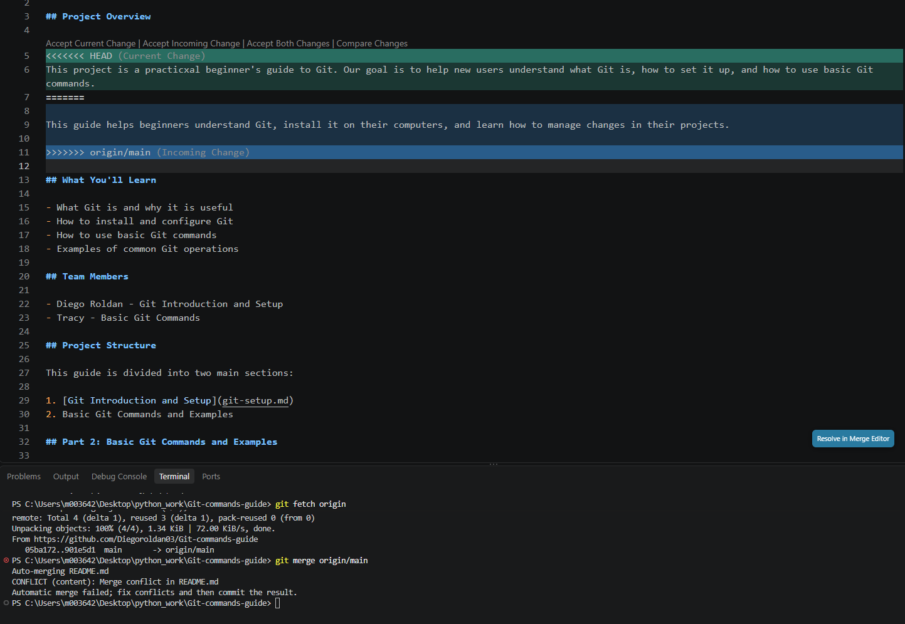

# Merge Conflict Resolution

## What Caused the Conflict

Both team members edited the Project Overview paragraph in `README.md` on separate branches.

## How the Conflict Was Detected

After Diego's branch was merged into `main`, Tracy merged the updated `main` branch into `feature/conflict-tracy`. Git reported a merge conflict in `README.md`.

## Conflict Screenshot

The screenshot below shows the merge conflict as it appeared in VS Code before it was resolved.

## How We Resolved It

We reviewed both versions of the paragraph and combined the ideas into one final version. The conflict markers were removed, and the resolved file was staged and committed.

## Final Steps

The resolved branch was pushed to GitHub, reviewed through a pull request, and merged into `main`.